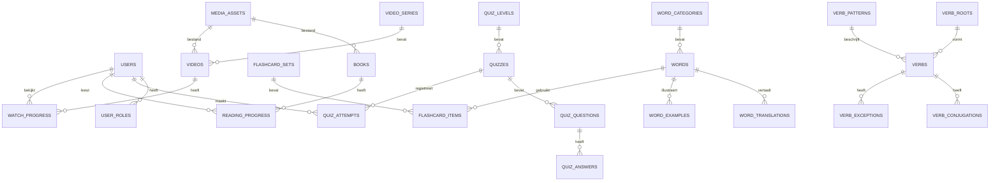

# Architectuur en implementatieplan

## Architectuur

React/TypeScript → Vite-proxy → Spring Security en REST → services/repositories → PostgreSQL. Flyway beheert het schema. Authenticatie gebruikt een server-side sessie met HttpOnly-cookie; mutaties vereisen een CSRF-token. Oorsprongen voor CORS staan expliciet in de configuratie. Productiebestanden horen buiten de database en buiten de publieke webroot, met autorisatie vóór levering. PDF-bestanden worden buiten de database opgeslagen en achter sessieautorisatie geleverd. Video’s staan buiten de database en worden achter sessieautorisatie geleverd. Productieopslag en productiebeheer zijn nog niet geïmplementeerd.

## ERD: beoogd model

Alleen het in de migraties aanwezige schema is daadwerkelijk geïmplementeerd. Relaties tussen ouders/docenten en leerlingen, publicatie en overige content vereisen verdere migraties.

## API

| Endpoint | Doel | Status |
| --- | --- | --- |
| GET /api/v1/auth/csrf | CSRF-cookie en token ophalen | basis |
| POST /api/v1/auth/login | sessie starten | basis |
| POST /api/v1/auth/logout | sessie beëindigen | basis |
| GET /api/v1/auth/me | huidige gebruiker | basis |
| GET /api/v1/words?q= | woorden zoeken | basis |
| POST /api/v1/words | woord toevoegen, ADMIN | basis |
| /api/v1/quizzes, /levels, /progress | meerkeuzequiz, niveaus en pogingen | eerste versie |
| /api/v1/verbs, /flashcards | taal en woordkaarten | gepland |
| /api/v1/books, /admin/books | PDF-metadata, afgeschermde inhoud en beheer | eerste versie |
| /api/v1/videos, /series, /admin/videos, /admin/series | video, series en kijkvoortgang | eerste versie |
| /api/v1/admin | content en gebruikers | gepland |

## React-structuur

`App` bevat de applicatieschil en routes; `ArabicText` centraliseert taalrichting en typografie; `Dictionary` verzorgt zoeken en woordweergave. Verdere modules krijgen eigen featuremappen, services en formulieren zodra hun backend bestaat.

## Fasering

1. Fundament: migraties, beveiligde sessies, CORS, React-schil en verticale woordenboekintegratie. **Basis aangelegd; integratietest ontbreekt; eerste beheerder wordt optioneel via omgevingsvariabelen aangemaakt.**
2. Arabisch: gecontroleerde lexicale inhoud, categorieën en een expliciete morfologische regelengine met uitzonderingen.
3. Leren: eerste meerkeuzequiz en opgeslagen resultaten aanwezig; kaartontwerp, PDF-export, volledig niveaubeheer en overige vraagtypen ontbreken.
4. Media: veilige uploads, afgeschermde PDF-viewer, video's, series en voortgang.
5. Beheer: gevalideerde contentworkflows, rollen, relaties en rapportages.
6. Afwerking: toegankelijkheid, beveiliging, herstelbare back-ups, end-to-endtests en productie-inrichting.

Elke fase vereist migraties en integratietests. Er worden geen vervoegingen gegenereerd zonder gecontroleerde grammaticale gegevens. Het aangeleverde logo staat in de navigatie.
